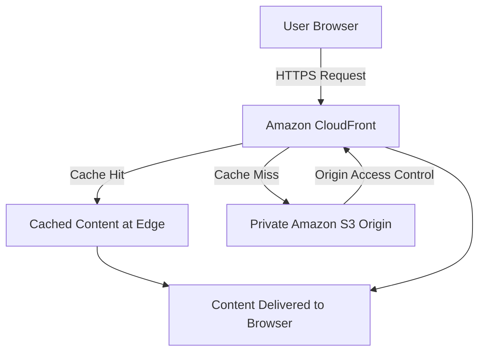

# ☁️ CLOUDSCAPE — Cloud-Native Engineering Portfolio

<p align="center">
  <strong>Engineering Beyond the Interface</strong><br/>
  An interactive portfolio exploring cloud architecture, content delivery, caching, and secure static web hosting.
</p>

<p align="center">
  <a href="https://d3l9jzdfmbsoxe.cloudfront.net">🚀 Live Demo</a> •
  <a href="https://github.com/Siddhi2006-coder">GitHub Profile</a> •
  <a href="https://www.linkedin.com/in/siddhi-shejwal/">LinkedIn</a>
</p>

---

## 📌 Project Overview

**CLOUDSCAPE** is a cloud-computing mini project that combines a responsive engineering portfolio with interactive learning tools for understanding cloud delivery architecture.

The project demonstrates how a static website can be delivered through **Amazon CloudFront** using **Amazon S3** as an origin, with an emphasis on HTTPS delivery, caching concepts, and private-origin security.

It also includes an interactive architecture lab and a configurable delivery simulator to explain how latency, cache-hit probability, and asset size can affect estimated content delivery time.

## 🎯 Objectives

- Understand the fundamentals of cloud-based static web hosting.
- Explore content delivery networks (CDNs) and edge caching.
- Demonstrate the relationship between Amazon S3 and Amazon CloudFront.
- Understand secure origin access using Origin Access Control (OAC).
- Simulate the impact of latency, cache hits, and asset size on delivery estimates.
- Build and deploy a responsive, accessible web application.

## ✨ Features

### 🏠 Interactive Portfolio
- Responsive layout for desktop, tablet, and mobile.
- Project showcase featuring EcoMind, SafeSphere, and CLOUDSCAPE.
- Technical skills, education, engineering journal, and about sections.
- Dark navy interface with cyan and violet accents.

### 🏗️ Interactive Architecture Lab
Explore the conceptual request flow:

`Browser → HTTPS/TLS → Amazon CloudFront → Private Amazon S3 Origin`

- Inspect individual architecture components.
- Explore their roles in content delivery and security.
- Simulate a request and observe educational cache-hit and cache-miss events.
- Learn about private S3 access, OAC, and least-privilege permissions.

### ⚡ Cloud Delivery Simulator
Experiment with three parameters:

- **Network latency:** 10–300 ms
- **Cache-hit probability:** 0–100%
- **Asset size:** 100 KB, 500 KB, 1 MB, or 5 MB

The simulator estimates delivery time using a simplified mathematical model. Its output is illustrative and is not measured AWS telemetry.

### 📚 Engineering Journal
Short educational articles covering caching, private S3 origins, and HTTPS delivery concepts.

## 🛠️ Technology Stack

| Technology | Purpose |
|---|---|
| HTML5 | Page structure |
| CSS3 | Responsive styling and visual design |
| JavaScript | Interactions and simulation logic |
| Amazon S3 | Static website asset storage |
| Amazon CloudFront | Content delivery |
| HTTPS/TLS | Encrypted transport |
| Origin Access Control (OAC) | Restricting CloudFront access to the S3 origin |
| Antigravity | Development workflow |

## 🏛️ Cloud Architecture



**How it works:**

1. A visitor opens the portfolio through the CloudFront HTTPS URL.
2. CloudFront checks whether the requested object is available in its cache.
3. On a cache hit, the cached object can be returned without fetching it from S3.
4. On a cache miss, CloudFront requests the object from the configured S3 origin.
5. Origin Access Control helps authorize CloudFront to access a private S3 bucket.

*This diagram describes the intended request flow. Actual behavior depends on the deployed distribution, origin configuration, cache policies, and permissions.*

## 🧮 Simulator Model

The simulator uses the following simplified assumptions:

- Throughput: 20 Mbps
- Edge overhead: 5 ms
- Origin overhead: 25 ms
- Latency represents a simplified round-trip time.
- A cache hit does not require an origin fetch.
- A cache miss includes an origin fetch.
- Decimal units are used: 1 MB = 1,000 KB.

### Transfer time

\[
T_{\text{transfer}} =
\frac{\text{Asset size in kilobits}}{20{,}000}
\times 1000
\]

### Estimated edge delivery time

\[
T_{\text{edge}} = L + 5 + T_{\text{transfer}}
\]

### Estimated origin delivery time

\[
T_{\text{origin}} = 2L + 25 + T_{\text{transfer}}
\]

### Expected delivery time

\[
T_{\text{expected}} =
pT_{\text{edge}} + (1-p)T_{\text{origin}}
\]

Where:

- \(L\) is the configured latency in milliseconds.
- \(p\) is the cache-hit probability expressed as a decimal.
- \(T_{\text{edge}}\) and \(T_{\text{origin}}\) are illustrative estimates.

The model excludes factors such as TLS connection setup, congestion, packet loss, retries, connection reuse, browser rendering, and real-world AWS network behavior. Therefore, these estimates should not be interpreted as production performance measurements.

## 🚀 Live Deployment

**Live application:**  
https://d3l9jzdfmbsoxe.cloudfront.net

The application is delivered through an Amazon CloudFront distribution.

The intended secure deployment configuration uses:

- Amazon S3 for static assets.
- Amazon CloudFront for content delivery.
- HTTPS for encrypted connections.
- Origin Access Control for private S3 origin access.
- `index.html` as the default root object.

The actual deployment configuration should be verified in the AWS Console before treating every security setting as confirmed.

## 💻 Run Locally

### Prerequisites

- Python 3 or another local static HTTP server.
- A local copy of the project files.

### Steps

1. Clone the repository:

   ```bash
   git clone https://github.com/Siddhi2006-coder/CLOUDSCAPE.git
   ```

   Replace the repository URL above if your actual repository has a different name or URL.

2. Open the project directory:

   ```bash
   cd CLOUDSCAPE
   ```

3. Start a local server:

   ```bash
   python -m http.server 3000 --bind 127.0.0.1
   ```

4. Open the application in your browser:

   ```text
   http://127.0.0.1:3000
   ```

5. Stop the server with `Ctrl + C` when finished.

No backend server or package installation is required for the described static frontend.

## 🔐 Security Considerations

- Keep Amazon S3 Block Public Access enabled.
- Use CloudFront Origin Access Control to authorize access to the private S3 origin.
- Apply least-privilege permissions in the S3 bucket policy.
- Serve the application over HTTPS through CloudFront.
- Never commit AWS access keys, secret keys, passwords, or other credentials to GitHub.
- Review AWS billing, credits, and usage before creating or retaining resources.

## 🧪 Testing Checklist

- [ ] Homepage loads through the CloudFront URL.
- [ ] Navigation works across desktop and mobile layouts.
- [ ] Project cards and architecture nodes behave correctly.
- [ ] Simulator controls update estimates as expected.
- [ ] No broken CSS, JavaScript, or image paths.
- [ ] HTTPS works without certificate warnings.
- [ ] S3 remains private and CloudFront can retrieve authorized objects.
- [ ] Browser console is free of unexpected errors.

Only mark tests as complete after running them.

## 🔮 Future Enhancements

- Add automated deployment using GitHub Actions.
- Configure custom-domain support and an SSL/TLS certificate.
- Add CloudFront access logging and performance analysis.
- Introduce real AWS metrics as a separate, clearly labelled monitoring feature.
- Add automated accessibility and performance tests.
- Extend the simulator to compare additional caching policies and network conditions.

## 🎓 Learning Outcomes

Through CLOUDSCAPE, the project explores:

- Static web application deployment.
- Cloud storage and content delivery.
- CDN caching fundamentals.
- Secure access to private cloud origins.
- Responsive frontend development.
- Mathematical modeling of content delivery.
- Cloud architecture documentation and testing.

## 👩‍💻 Author

**Siddhi Shejwal**  
B.E. Computer Engineering Student  
Bharati Vidyapeeth College of Engineering for Women, Pune

- GitHub: [Siddhi2006-coder](https://github.com/Siddhi2006-coder)
- LinkedIn: [siddhi-shejwal](https://www.linkedin.com/in/siddhi-shejwal/)

## 📄 Project Status

CLOUDSCAPE is an academic cloud-computing learning project. Its architecture lab and delivery simulator are educational demonstrations, not a production monitoring platform.

---

*Built to explore cloud architecture, secure content delivery, and engineering beyond the interface.*
